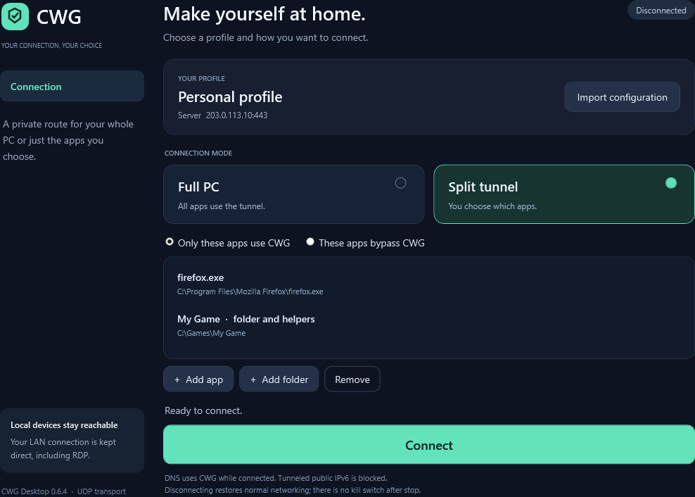

# CWG — customwireguard

CWG is an experimental, UDP-only carrier for WireGuard, with a Windows desktop
app and a Debian server installer. Self-host it on your own server; no public
VPN service or shared credentials are provided. Each authenticated, encrypted and padded
client request allows one same-sized server reply. Native WireGuard still
handles the inner VPN encryption and peer identity.

**Version 0.6.4 is the first public release**, with an MIT license, public setup
guides and audited source/downloads. It retains the verified 0.6.3 transport and
disconnect recovery. Existing servers and profiles remain compatible; the
bandwidth experiment is not enabled. This is experimental software, not a promise
of undetectable traffic or universal connectivity.

- Windows desktop controls for Full PC or per-application split tunneling.
- UDP-only authenticated request/reply carrier around native WireGuard.
- Debian 13 installer, separate user profiles, and optional owner-only Telegram
  management for up to three active accounts.
- No personal server details, tokens or preconfigured profiles in public downloads.



The preview uses invented settings; public downloads start unconfigured.

## Download

[Release and checksums](https://github.com/tnt1576-a11y/customwireguard/releases/tag/v0.6.4)

| Package | Purpose |
|---|---|
| `cwg-windows-0.6.4.zip` | Shareable Windows app and offline routing engine; no account credentials |
| `cwg-server-0.6.4.zip` | Fresh Linux server installer, binaries, client-export helpers and documentation |
| `*.zip.sha256` | SHA-256 checksum for the matching archive |

Downloads are public. You still need a private profile from your own server
administrator to connect. Compare the archive's SHA-256 with its `.sha256` file
before extracting it; on Windows use `Get-FileHash .\cwg-windows-0.6.4.zip`.
**Share the original ZIP, not an app folder after importing a profile.** Private
`.cwg` files and server-exported client ZIPs contain connection keys.

## Windows: connect without terminal commands

Requires 64-bit Windows 10/11, .NET Framework 4.8 and administrator permission.

1. Extract **all** of `cwg-windows-0.6.4.zip` into a writable local folder. Keep
   `CWG.exe`, `bin` and `scripts` together.
2. Double-click **CWG.exe** and accept the administrator prompt.
3. Click **Import configuration** and select your private `.cwg` file. Each
   simultaneous device needs its own account.
4. Choose **Full PC**, or **Split tunnel** with **Only these apps use CWG** or
   **These apps bypass CWG**. Add program executables or installation folders.
5. Click **Connect**. Restart apps whose existing connections need to move.
6. Click **Disconnect** to restore normal networking. Closing while connected
   keeps CWG in the tray; its menu also offers Disconnect and quit.

The shareable ZIP includes its verified engine ready to run offline. WireGuard
Windows and WireSock are not required. Stop other VPN sessions before connecting.
The executable is currently unsigned.

Local IPv4 LAN connections, including RDP, stay direct. Ordinary Windows DNS
uses CWG while connected, including DNS for bypassed apps. Tunneled public IPv6
is blocked because the current server provides IPv4 Internet egress only.
**There is no persistent kill switch after disconnect or routing-engine exit.**
See [application behavior and recovery](docs/APPLICATION-CLIENT.md).

To update, disconnect, extract the new ZIP into a new folder and import your
existing `.cwg` profile. Do not mix helpers from different releases. If an older
app cannot disconnect, dismiss its error and close the UI process using Task
Manager if necessary; open the new app and click **Disconnect**. It detects the existing
session without needing another profile import. Do not grant yourself access to
`C:\ProgramData\CWG-AppTunnel` through Explorer; the app manages that directory.

## Server installer: fresh Debian 13

Use Debian 13 with systemd and amd64 or arm64. The amd64 installer has been
exercised in Debian 13; arm64 is cross-compiled but not runtime tested. This is
a **fresh install**, not an upgrade command for an existing CWG server.

Download `cwg-server-0.6.4.zip` and its `.sha256` file from the release, then copy
both to a private server directory. Run as root:

```sh
# If these tools are missing:
apt-get update
apt-get install -y python3 unzip

sha256sum -c cwg-server-0.6.4.zip.sha256
unzip -q cwg-server-0.6.4.zip
cd cwg-server-0.6.4
ip -4 route get 1.1.1.1
```

Use the route's `dev` interface and your server's public IPv4 address below.
Replace `eth0` and `YOUR_SERVER_IPV4`:

```sh
python3 deploy/linux/setup.py install --release . --endpoint YOUR_SERVER_IPV4:443 --wan eth0
python3 /usr/local/lib/cwg/server-admin.py verify
```

Allow **UDP 443** in the provider and host firewalls, plus forwarding between
`cwg0` and the chosen WAN. CWG's own accept rules cannot override another
firewall's drop rules. The installer obtains missing Debian packages, installs
WireGuard and services, and configures forwarding and IPv4 NAT. It preserves
SSH and the default route. The native WireGuard backend on UDP 51820 stays
private; do not expose it externally.

The installer asks **Enable Telegram management? [y/N]**. If enabled, enter a
bot token at the hidden prompt, then your numeric Telegram user ID or complete
the one-time pairing link. If disabled, CWG still works. The initial owner's
private Windows package is `/etc/cwg/client.zip`; transfer it securely. It
includes a configured desktop app, with engine installation on first use.

Full checks, repeated-install behavior, rollback and removal are documented in
[the server installation guide](docs/SERVER-SETUP.md). Tunnel networks are
`10.77.0.0/24` and `fd77:77:77::/64`; conflicting installations are refused.

## Add another user

The server supports **up to three active accounts**, including the owner, with
independent keys, queues and negotiated rate sharing. Speed depends on the
server and network. In your bot's private chat:

| Command | Action |
|---|---|
| `/start`, `/help` | Instructions |
| `/status`, `/users` | Health, counters and accounts |
| `/add alice` | Create Alice's account and send `alice.cwg` to the owner |
| `/config alice` | Resend Alice's active profile |
| `/config owner` | Export the initial owner's profile |
| `/revoke alice` | Revoke Alice's access |

Send Alice the original shareable Windows ZIP and **her** `.cwg` file. Only the
authorized owner can manage accounts. Bot documents are ordinary Telegram
messages, not Secret Chats; treat profiles and your Telegram account as secrets.
No bot token or server private key is included in user profiles.

Telegram can be enabled or disabled later. See [Telegram setup](docs/TELEGRAM.md)
and [SSH-only provisioning](docs/MULTI-USER.md).

## Costs and limits

- **Extra traffic:** downloads require padded upload requests. Small packets
  are expensive relative to their useful contents; repair can carry duplicates.
  There is no fixed overhead percentage. At four requests/s idle, average
  1420-byte requests/replies total about **40.9 MB/hour sent + received**, before
  outer IP/UDP and link overhead. Active traffic raises the rate automatically.
  Short mixed tests used 198-265 MB of combined interface traffic for 20 MiB of
  bulk transfers plus probes; padding, polling and repair can greatly exceed
  the ideal full-packet estimate. Bandwidth reduction is separate work.
- **CPU and latency:** outer encryption, padding, copies and UDP I/O add work.
  Windows also runs a separate routing/WireGuard engine. Queueing and loss
  recovery trade latency against delivery.
- **Detection remains possible:** UDP 443 here is custom encrypted UDP, not
  HTTPS. Addresses, timing, sizes and traffic volume remain observable. There
  is no promise of future DPI resistance or protection from server IP blocking.
- **Research status:** no independent security audit or universal speed and
  reliability guarantee. Short tests do not establish long-term behavior.

[Bandwidth calculations, CPU findings and optimization priorities](docs/PERFORMANCE.md)
separate measurements from proposals.

## Privacy, support and license

Never attach a `.cwg` profile, a server-generated client ZIP, bot token or raw
diagnostic capture to an issue. Redact addresses, keys, usernames and local paths.
See the [security policy](SECURITY.md) for private vulnerability reporting and
the [public-release audit](docs/PUBLIC-RELEASE.md) for what was checked.

CWG's own source and documentation are under the [MIT license](LICENSE).
Dependencies retain their own licenses. The bundled sing-box engine is
GPL-3.0-or-later; see [third-party notices and source links](THIRD_PARTY.md).
For ordinary bugs, open a sanitized issue; for development, see
[Contributing](CONTRIBUTING.md).

## Validation and development

Exact 0.6 transport release comparisons with three accounts returned 6595/6596
and 6598/6598 application probes in two short runs. These are application
delivery counts, not proof of zero outer loss. The 0.6.1 UI trials covered Full
PC, Include and Exclude routing, DNS/LAN behavior and cleanup. The 0.6.3 CPU
comparison returned 798/798 probes in each version. Disconnect recovery and
the exact packaged app checks are recorded in [validation](docs/VALIDATION.md).

Build in Windows PowerShell with Go available (or `.tools/go/bin/go.exe`) and
the .NET Framework compiler:

```powershell
.\scripts\Build.ps1 -Version 0.6.4
.\scripts\Package-Desktop.ps1 -Release RELEASE_FOLDER -EngineArchive OFFICIAL_SING_BOX_ZIP -Destination NEW_APP_FOLDER
```

The packager accepts only the pinned engine archive, preserves dependency
notices, includes runtime essentials and writes checksums. Never include private
profiles, tokens, logs, captures or test harnesses in public packages.

Further documentation: [transport](docs/EXCHANGE.md),
[multi-user scheduling](docs/MULTI-USER.md), [DPI and resilience](docs/RESILIENCE.md),
[separate-PC testing](docs/REMOTE-TESTING.md), and
[historical HTTP/3 experiment](docs/HTTP3.md).
